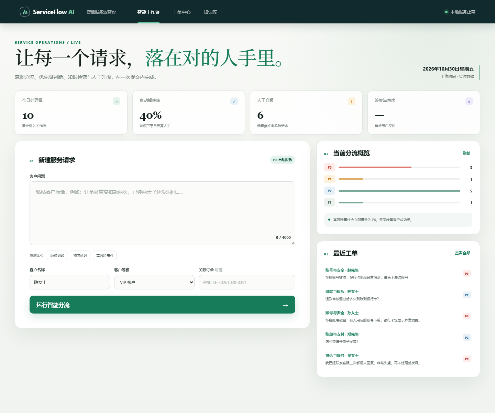

# ServiceFlow AI：企业工单分流 + 知识库问答助手

一个可直接运行的服务运营项目：接收客户问题后，通过 LangGraph 编排敏感信息脱敏、业务意图识别、风险与紧急度评估、知识库检索、带来源答复、人工升级和工单沉淀。

项目使用 FastAPI 提供服务，默认不需要联网或 API Key；在 `.env`
配置 OpenAI 兼容模型后，可在原有证据约束流程上启用生成式回答。



## 为什么做

企业客服并不只需要一个聊天框。真实工作流还要回答：

- 这条请求属于哪个业务团队？
- 是否涉及资金、账号或监管投诉等高风险事件？
- 能否用已有知识可靠解决？
- 自动答复的依据是什么？
- 低置信问题如何转人工，处理结果和用户反馈如何沉淀？

ServiceFlow AI 将这些决策放在同一条可审计的流水线里。

## 功能

- **工单分流**：账单、账号、物流、退款、技术、投诉、通用咨询 7 类意图。
- **优先级策略**：P0-P3 分级；资金安全、账号被盗、监管投诉等风险强制升级。
- **混合知识检索**：查询改写、BM25、离线哈希向量和启发式 Rerank 组合排序，支持类目加权和段落级来源。
- **文档入库**：通过 API 上传 Markdown 或 TXT 文档，解析、切分并持久化到知识索引。
- **安全答复**：低相关性、低置信和高风险请求不会被直接自动回复。
- **可选大模型**：仅使用检索证据生成答复；模型超时或不可用时回退到本地抽取式答案。
- **隐私保护**：手机号、邮箱、证件号、银行卡号和常见订单号在入库前脱敏。
- **运营闭环**：工单状态、负责团队、SLA、用户反馈、自动解决率与升级率。
- **Agent 编排**：LangGraph 条件分支、自动工单节点、人工交接节点和逐步执行轨迹。
- **会话与流式输出**：持久化多轮会话，追问可携带上下文，SSE 返回节点进度和答案增量。
- **可审计工具层**：知识检索、查询工单、创建工单和人工交接均返回结构化调用记录。
- **响应式工作台**：智能分流、工单中心、知识库三个视图，适配桌面和移动端。

## 快速运行

需要 Python 3.10 或更高版本。首次运行先创建独立虚拟环境并安装依赖：

```powershell
cd enterprise-ticket-assistant
python -m venv .venv
.\.venv\Scripts\python.exe -m pip install -e .
.\.venv\Scripts\python.exe run.py seed-demo
.\.venv\Scripts\python.exe run.py serve
```

浏览器打开 <http://127.0.0.1:8877>。首次启动会自动创建 `.data/serviceflow.db`，演示工单不会被提交进 Git。如果端口被占用，可使用 `python run.py serve --port 9000`。

只启动服务、不写入演示数据：

```powershell
.\.venv\Scripts\python.exe run.py serve
```

命令行验证一次分流：

```powershell
.\.venv\Scripts\python.exe run.py assist --message "退款审核通过后多久到账？" --tier vip
```

## 可选模型配置

项目默认关闭大模型，此时答案为“本地抽取 + 引用”，可完全离线演示。

复制 `.env.example` 为 `.env`，填写自己的 API Key、服务地址和模型名称。
DeepSeek 示例：

```dotenv
SERVICEFLOW_LLM_ENABLED=1
OPENAI_API_KEY=your-private-key
OPENAI_BASE_URL=https://api.deepseek.com
SERVICEFLOW_MODEL=deepseek-chat
```

密钥只从环境变量或被 Git 忽略的 `.env` 读取。模型调用包含超时、有限重试、
并发限制和 Token 用量记录；失败时会自动回退到本地抽取式答案。

## 核心流程

```text
客户问题
   │
   ├─ PII 脱敏
   ├─ 意图分类 + 风险/紧急度打分
   ├─ 按意图过滤知识库
   ├─ BM25 / 中文二元词召回
   ├─ 相关性阈值 + 风险策略
   │      ├─ 自动答复（带引用）
   │      ├─ 转人工复核
   │      └─ P0/P1 强制升级
   └─ SQLite 工单 + 反馈 + 指标
```

更完整的设计说明见 [docs/architecture.md](docs/architecture.md)。

## API

| 方法 | 路径 | 说明 |
| --- | --- | --- |
| `GET` | `/api/health` | 服务与知识库状态 |
| `GET` | `/api/agent/info` | Agent 框架、节点和路由信息 |
| `GET` | `/api/model/info` | 模型配置状态、超时和并发参数 |
| `POST` | `/api/model/test` | 发起一次最小模型连通性测试 |
| `POST` | `/api/assist` | 分流、检索、答复并创建工单 |
| `GET` | `/api/tickets` | 工单列表，支持状态与数量筛选 |
| `POST` | `/api/tickets/{id}/status` | 更新人工处理状态 |
| `POST` | `/api/tickets/{id}/feedback` | 记录“有帮助 / 需优化”反馈 |
| `GET` | `/api/metrics` | 业务指标聚合 |
| `GET` | `/api/knowledge` | 知识文档列表 |
| `GET` | `/api/retrieval/search` | 查看关键词、向量和混合相关性得分 |
| `POST` | `/api/knowledge/reload` | 重新载入 Markdown 知识 |
| `GET` | `/api/documents` | 查看已上传文档及切分数量 |
| `POST` | `/api/documents` | 上传 Markdown 或 TXT 文档并建立索引 |
| `GET` | `/api/documents/{id}` | 查看文档元数据 |
| `POST` | `/api/sessions` | 创建多轮会话 |
| `GET` | `/api/sessions/{id}` | 查看会话和历史消息 |
| `POST` | `/api/chat` | 在会话中运行 Agent 并返回完整结果 |
| `POST` | `/api/chat/stream` | 以 SSE 流式返回 Agent 节点和答案 |
| `GET` | `/api/tools` | 查看 Agent 可用工具及输入结构 |
| `POST` | `/api/tools/knowledge_search` | 单独调用知识检索工具 |
| `POST` | `/api/tools/get_ticket` | 单独调用工单查询工具 |

示例：

```powershell
$body = @{
  message = "怀疑账号被盗，银行卡出现异常消费"
  customer_name = "陈女士"
  customer_tier = "vip"
} | ConvertTo-Json

Invoke-RestMethod -Uri "http://127.0.0.1:8877/api/assist" `
  -Method Post -ContentType "application/json" -Body $body
```

## 测试与评测

```powershell
python -m unittest discover -s tests -v
python scripts\evaluate.py
```

当前基线来自 21 条人工编写的领域问法：

| 指标 | 结果 | 口径 |
| --- | ---: | --- |
| 意图分类准确率 | 100% | 21 条内部评测问法 |
| 意图 Macro-F1 | 100% | 7 个业务类目 |
| 知识 Hit@1 | 100% | 是否命中期望文档 |
| 知识 Hit@3 | 100% | Top 3 是否包含期望文档 |
| 优先级准确率 | 100% | 21 条评测问法回归通过 |
| 优先级降级漏判 | 0 条 | 真实优先级高于系统判断 |

这是小规模合成评测，只用于回归和展示，不代表生产流量准确率。评测脚本在 [scripts/evaluate.py](scripts/evaluate.py)，数据在 [data/evaluation.jsonl](data/evaluation.jsonl)。

## 目录

```text
enterprise-ticket-assistant/
├─ serviceflow/          # 分流、检索、策略、存储、HTTP API
├─ knowledge/            # 可热更新的 Markdown 知识库
├─ web/                  # 无构建步骤的响应式工作台
├─ tests/                # 单元与端到端业务流测试
├─ scripts/evaluate.py   # 离线分类/检索评测
├─ data/evaluation.jsonl
└─ docs/                 # 架构与评测说明
```

## 设计边界

- 规则分类器可解释、启动快，但同义表达泛化能力弱于经过标注数据训练的模型；生产环境应接入真实工单数据，对比规则、传统分类模型与语义向量模型。
- 当前 BM25 检索适合中小型知识库。文档规模扩大后，可接入向量检索并保留关键词召回作为 hybrid search。
- SQLite 适合单机展示和小团队内部工具。多实例部署时应迁移到 PostgreSQL，并增加登录、RBAC、审计和消息队列。
- 当前服务没有外部身份认证，不应直接暴露在公网。


