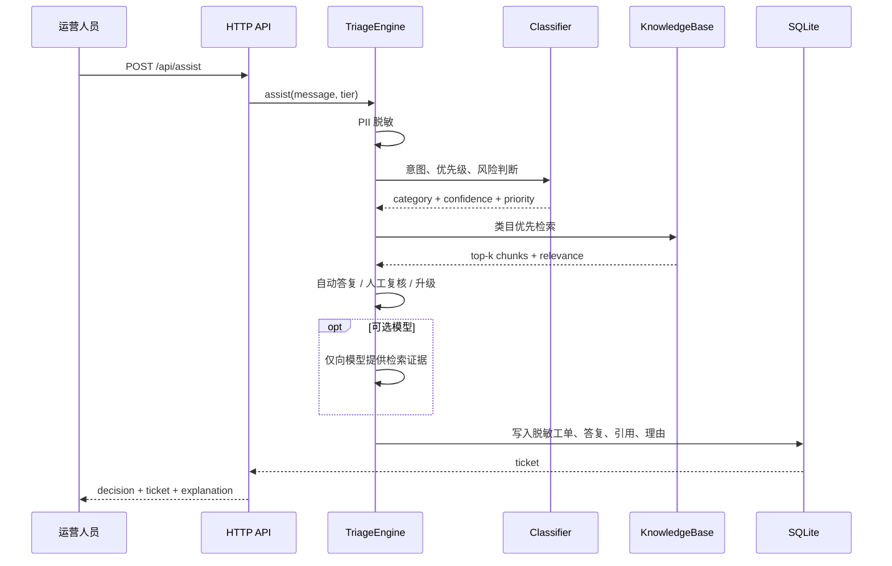

# 系统设计说明

## 目标与约束

这个项目的核心不是“调用一个聊天模型”，而是在自动答复前加入可解释的业务决策：

1. 请求是否属于某类业务问题；
2. 风险是否足以阻止自动处理；
3. 知识库是否提供了足够相关的依据；
4. 如果无法可靠回答，应该去哪个团队；
5. 答复、来源、判断理由和反馈如何留痕。

项目要求零配置可演示，因此默认只使用 Python 标准库。模型调用被设计为可选的最后一步，而不是主流程的单点依赖。

## 组件

| 组件 | 文件 | 职责 |
| --- | --- | --- |
| HTTP API | `serviceflow/api.py` | FastAPI 路由、JSON API、参数校验、OpenAPI 文档 |
| 分流引擎 | `serviceflow/engine.py` | 串联脱敏、分类、检索、答复和策略 |
| 意图分类 | `serviceflow/classifier.py` | 7 类意图、P0-P3、风险信号和解释 |
| 知识检索 | `serviceflow/knowledge.py` | Markdown 切片、索引、BM25、引用句抽取 |
| 隐私处理 | `serviceflow/pii.py` | 标识符检测、脱敏哈希 |
| 工单存储 | `serviceflow/storage.py` | SQLite 事务、筛选、反馈和指标 |
| 模型适配 | `serviceflow/llm.py` | OpenAI 兼容接口与安全回退 |
| 工作台 | `web/` | 人工操作、工单与知识展示 |

## 请求时序



## 分流策略

### 意图分类

分类器对业务关键词进行加权，取分数最高的类目。置信度由三部分组成：

- 最高分类得分；
- 第一与第二类目的分差；
- 无明显意图时进入 `general` 并降低置信度。

这种方式透明、可快速冷启动，但同义词需要维护。生产化时应把规则分类器作为基线，使用真实标注工单训练 TF-IDF/线性分类器或小型语义模型，并用混淆矩阵决定哪类错误成本最高。

### 优先级

- `P0`：资金安全、账号被盗、数据丢失、监管投诉、人身安全等高风险信号。
- `P1`：强时效、重复失败、企业客户普遍不可用或 VIP 负向情绪。
- `P2`：需要业务团队处理但尚未达到紧急标准。
- `P3`：普通咨询和低时效问题。

“风险词”和“紧急词”分开计分，防止把普通催促误判为安全事故。

### 自动答复门槛

同时满足以下条件才自动答复：

- 意图置信度不低于 0.56；
- 最高知识相关性不低于 0.66；
- 未触发 P0 或高风险词；
- 至少召回一条达到最低相关性的知识。

任一条件失败都会进入人工复核或升级。模型不能覆盖这些策略判断。

## 检索设计

知识文档采用 Markdown frontmatter：

```yaml
---
id: refund_timing
title: 退款审核与到账时效
category: refund
team: 售后服务组
---
```

正文按空行切片。中文检索同时保留单字和二元词，英文与编号保留完整 token；使用 BM25 计算词项相关度，并按业务类目加权。最终相关性还包含查询词项覆盖率，减少“一个常用字碰巧命中”的误召回。

返回答案始终包含来源文档、段落和相关性；模型只收到这些段落，不直接读取整个知识库。

## 存储

SQLite 保存：

- 原始问题和脱敏后问题；
- 客户、等级、订单号；
- 类目、优先级、置信度和相关性；
- 工单状态、负责团队、答复、引用和判断理由；
- 反馈记录。

原始问题仍然保留是为了复盘误分类，但 API 展示默认使用脱敏文本。生产环境应进一步拆分敏感数据存储、设置访问权限和自动过期策略。

## 可观测性

当前指标：

- 自动解决率；
- 人工升级率；
- 类目分布；
- 优先级分布；
- 用户有帮助率。

生产环境还应增加：

- 各意图置信度分位数；
- 人工改判率；
- 检索无答案率；
- P95 响应时间；
- 模型回退率；
- 按团队、客户等级与知识版本的处理时长。

## 安全边界

已实现：

- 请求体大小上限；
- 参数长度和枚举校验；
- SQL 参数化查询；
- 静态文件路径约束；
- 前端内容 HTML 转义；
- PII 入库前脱敏；
- 低证据不生成事实性答案。

部署前必须补充：

- 登录与会话管理；
- RBAC 和审计日志；
- HTTPS；
- 限流和 CSRF 策略；
- PostgreSQL 与备份；
- 密钥管理；
- 数据保留与删除策略。

